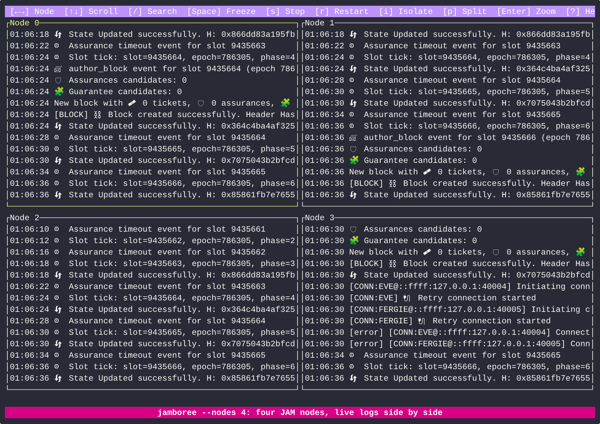

<p align="center"></p>

<h1 align="center">jamboree</h1>

<p align="center">Launch a local network of any JAM client, watch every node's logs side by side, and break it on purpose.</p>

For milestone M2, JAM client teams run testnets of many nodes, often from different clients.
jamboree starts them all from one command, shows their live logs in one terminal grid and
saves every log. It can also stop, isolate, split or restart nodes, and add delay, jitter or
packet loss between them, which is where many of the hard bugs show up. Saved logs, from jamboree or anywhere else, open in the same grid.



Download a binary for Linux or macOS (x86_64 or arm64) from
[Releases](https://github.com/jamixir/jamboree/releases/latest). If macOS blocks it, run
`xattr -d com.apple.quarantine jamboree`. Or build it with
`cargo install --git https://github.com/jamixir/jamboree`. Then:

```sh
jamboree --nodes 6 --cmd 'cd ~/src/jamixir && ./node.sh {i}'
```

That starts six Jamixir nodes. For any other client, put the command that starts one node in
`--cmd`; jamboree runs it once per node with `{i}` replaced by 0, 1, 2, ... Linux and macOS,
no root. From a clone, `cargo run -- <args>` works the same.

Built while developing [Jamixir](https://jamixir.org).

## Start a network

`--cmd` runs once per node with `sh -c`. `{i}` becomes the node index (0, 1, 2, ...), and
`--nodes` sets how many (default 6). Each node's output goes to its own pane.

For a mixed network, repeat `--cmd` to run one node per command, prefix `label=` to title
the panes, and `label[K]=` to run K nodes from one command (`[K]=` without a label):

```sh
jamboree --cmd 'theirs[4]=./their-jam-node <flags for node {i}>' \
         --cmd 'mine[2]=./my-jam-node <flags for node {i}>'
```

That is six nodes: `theirs 0` to `theirs 3`, then `mine 4` and `mine 5`.

Placeholders in `--cmd`:

| Placeholder | Becomes | Also as |
| --- | --- | --- |
| `{i}` | the node index: 0, 1, 2, ... | |
| `{port}` | the port the node listens on | `$PORT` |
| `{telemetry}` | a HOST:PORT for the node's telemetry, see [JIP-3 telemetry](#jip-3-telemetry) | `$TELEMETRY` |
| `{container}` | a container name for `docker run --name`, see Docker under [Recipes](#recipes) | |

Any other `{word}` is an error. `--dry-run` prints each node's command and exits.

Every run is saved to `logs/<timestamp>/node_<i>.log`, with the command line in `cmd.txt`.

## Follow an event across nodes

- Scrolling a pane (arrows, wheel) freezes only that pane; `Space` resumes it. With nothing
  frozen, `Space` freezes all panes at once, to compare them at one moment. The nodes keep
  running either way.
- `/` searches: it highlights up to 6 comma-separated terms in every pane, each in its own
  colour. Paste a block hash to follow it through the network. `n`/`N` jump between matches.
  In the search box, `Ctrl+W` drops the last term and `Ctrl+U` all of them.
- `Ctrl+G` filters: each pane shows only the lines that match (it asks for terms if there
  are none). `Ctrl+G` again shows all lines.
- `c` clears the search and the filter.
- `Enter` zooms into the focused pane, `Esc` goes back, `1`-`6` hide or show node 0 to 5.
- `--search 'error,warning'` sets the terms at start, also with `--logs`.
- To copy log lines: `Enter` to zoom the pane, scroll to them, `m` to turn the mouse off, then
  drag to select and copy as usual. The zoomed pane has no side borders, so the selection is
  just the log text. `m` again turns the mouse back on.

## Read saved logs

```sh
jamboree --logs logs/20261018_145800
```

`--logs` opens any folder of `*.log` files, one pane per file in natural order (`node_2` before
`node_10`): a past jamboree run, logs from CI, or files collected from other machines. Search,
`Ctrl+G`, zoom and scrolling work as in a live run; the network keys do not. `--nodes N` opens
only the first N files.

## JIP-3 telemetry

For clients that send [JIP-3](https://github.com/polkadot-fellows/JIPs/blob/main/JIP-3.md)
telemetry, put `--telemetry {telemetry}` in `--cmd`. jamboree gives each node its own address,
listens there, and writes these events in the node's pane and log:

| Event | Line |
| --- | --- |
| Best block changed | `[jip3] best block <slot> <hash>` |
| Finalized block changed | `[jip3] finalized <slot> <hash>` |
| Sync status changed | `[jip3] in sync: yes` or `no` |
| Authoring failed | `[jip3] authoring failed: <reason>` |
| Block verification failed | `[jip3] block verification failed: <reason>` |
| Block execution failed | `[jip3] block execution failed: <reason>` |
| Peer misbehaved | `[jip3] peer misbehaved: 0x<first 4 bytes of its peer ID>: <reason>` |

A node that has not connected after 60 seconds gets a `no JIP-3 telemetry` line in its pane:
usually the client's telemetry flag is misspelt or missing.

These lines look the same for every client, so one search follows a hash or a failure across
a mixed network. They also give the head check in [Run in CI](#run-in-ci) its input:
`--head jip3` compares the nodes' last best block and `--head jip3-final` their last finalized
block, with no regex per client. A restarted node connects again.

```sh
# six Jamixir nodes; Ctrl+G with the search below lists each node's best blocks
jamboree --nodes 6 --search 'best block' \
  --cmd 'cd ~/src/jamixir && ./node.sh {i} --telemetry {telemetry}'

# a mixed network: the same flag on every client that supports it
jamboree --cmd 'theirs[4]=./their-jam-node <flags for node {i}> --telemetry {telemetry}' \
         --cmd 'mine[2]=./my-jam-node <flags for node {i}> --telemetry {telemetry}'
```

`--dry-run` shows the address each node gets.

## Break the network

This is what a tmux layout or a shell script cannot do. Focus a node (arrows or click), then:

| Key | Fault |
| --- | --- |
| `s` | Stop the node (SIGSTOP). It stays connected but goes silent. `s` again continues it. |
| `i` | Isolate the node from all others. `i` again heals. |
| `p` | Split the network: the nodes before the focused one on one side, the rest on the other. `p` again heals. |
| `r` | Restart the node: kill it and run its command again. |

Isolate and split drop packets in both directions, like a broken link. Every fault writes a marker line
into every node's log, so each log shows when it happened.

The same faults can run on a schedule, at a time after the start:

```sh
jamboree --nodes 6 --cmd '...' \
  --fault '60s split 0,1,2/3,4,5' --fault '120s heal' --fault '150s restart 2'
```

Actions: `stop N`, `isolate N`, `split A/B`, `restart N`, and `heal` (continue, un-isolate
and unsplit everything). Times look like `90s` or `2m`; no time means at the start.

`--chaos SEED` adds a random schedule: every 20-60s a stop, isolate, split or restart, healed
20-60s later. The same seed and node count give the same schedule, and each run saves it as
`--fault` arguments in `faults.txt`, ready to replay or trim when a run finds a bug. Without
`--headless` the schedule runs for an hour.

### Slow or lossy network

`--delay`, `--jitter` and `--loss` act on every packet between nodes, in each direction, for
the whole run:

```sh
jamboree --nodes 6 --cmd '...' --delay 100ms --jitter 20ms --loss 1
```

| Flag | Effect |
| --- | --- |
| `--delay 100ms` | Holds back each packet by 100ms |
| `--jitter 20ms` | Varies that delay by up to 20ms either way (80-120ms), so packets can arrive out of order |
| `--loss 1` | Drops 1% of the packets at random |

Faults (the keys, `--fault`, `--chaos`) apply on top: while a split or isolation is on, the
packets between cut-off nodes are dropped, and the rest still get the delay and loss. For
example, a split and heal on a slow, lossy network:

```sh
jamboree --nodes 6 --cmd '...' --delay 100ms --jitter 20ms --loss 1 \
  --fault '60s split 0,1,2/3,4,5' --fault '120s heal'
```

## Run in CI

`--headless DURATION` runs the same network without the UI, then stops the nodes. With
`--head`, it checks that every node ended on the same head and exits 1 if not (2 for a setup
error, such as a bad `--fault`). That puts a
whole network run into a team's test cycle: a script or CI job can replay a fixed `--fault`
scenario, or run `--chaos SEED` with a new seed each night, and fail when the nodes disagree:

```sh
# a fixed scenario
jamboree --nodes 6 --cmd 'cd ~/src/jamixir && ./node.sh {i} --telemetry {telemetry}' \
  --fault '60s split 0,1,2,3/4,5' --fault '120s heal' \
  --headless 3m --head jip3

# a nightly chaos run; a failing seed reruns the same schedule (also saved in faults.txt)
jamboree --nodes 6 --cmd 'cd ~/src/jamixir && ./node.sh {i} --telemetry {telemetry}' \
  --chaos "$(date +%Y%m%d)" --headless 10m --head jip3
```

`--head jip3` takes each node's last best block from its [JIP-3 telemetry](#jip-3-telemetry),
so it reads every client alike; `--head jip3-final` takes the finalized block, which can no
longer reorg. After DURATION, jamboree waits up to `--timeout` (default 60s) for all nodes to
agree, then prints either the head or which nodes are on which. Stopped nodes are left out.

For a client without telemetry, give a regex instead: the head is what its first group captures
in the node's last matching log line, e.g. `--head 'Imported (0x[0-9a-f]+)'`. For a mixed
network, give each client its own regex with a label: `--head 'polkajam=Imported (0x[0-9a-f]+)'`.
Clients shorten hashes differently, so there capture something they print alike, such as the slot.

<details>
<summary>Head regexes for clients without telemetry</summary>

| Client | `--head` |
| --- | --- |
| Jamixir | `State Updated successfully\. H: (0x[0-9a-f]{64})` |
| PolkaJam | `Imported (0x[0-9a-f]+)` |
| JAM DUNA | `(?:Imported\|Authored) Block".* h=(\S+)` |
| PBnJam | `"blockHash":"(0x[0-9a-f]+)` |
</details>

## Talk to the network: `jamboree rpc`

Once a network runs, `jamboree rpc` reads its state, submits work-packages and deploys
services over [JIP-2](https://github.com/polkadot-fellows/JIPs), from the chain spec alone,
so the same commands work against any client that serves JIP-2:

```sh
R="jamboree rpc --url ws://127.0.0.1:19800 --chain-spec spec.json"
$R head                                  # best and finalized blocks
$R authorizer                            # the authorizer the genesis pools accept, and its cores
$R deploy my-service.jam --state my.json # create it through the Bootstrap service, provide its code
$R submit 2 0x0102 --wait                # one work-item in its own package; waits for Reported
$R read 2 0x6e663a…                      # a storage value (0x-hex key, or text)
$R status <package> <anchor>             # JIP-2 workPackageStatus
```

`submit` builds a GP 0.8.0 work-package: the best block's parent as the anchor, the finalized
block's parent as the lookup anchor (the anchor itself if finality lags past the lookup
window), the service's code hash at the anchor, all the gas a package allows, and the
authorizer found in the genesis pools (a preimage of some service whose empty-configuration
hash is in a core's pool; name one with `--authorizer host:code_hash` otherwise). It tries
the authorizer's cores round robin; `--core N` pins one, which a chain of packages that
depend on each other needs. `deploy` sends `CreateService` to the Bootstrap service
(jam-bootstrap-service 0.1.29's layout), resends a package that fails or ages out,
provides the code with `submitPreimage`, and waits until the code is at the lookup anchor
the next package will name; with `--state` it reuses a service already running the code.

## Recipes

Runs PolkaJam (release binary) and Jamixir networks.

<details>
<summary>Jamixir</summary>

```sh
jamboree --nodes 6 --cmd 'cd ~/src/jamixir && ./node.sh {i}'
```

Extra `node.sh` flags go into the command, e.g. `./node.sh {i} -x 4`.
</details>

<details>
<summary>PolkaJam</summary>

PolkaJam's genesis port cannot be shared, so give it another loopback address (Linux; on
macOS run `sudo ifconfig lo0 alias 127.0.0.2` once). Drop `--pvm-backend interpreter` if
your machine supports `userfaultfd`.

```sh
jamboree --nodes 6 --cmd 'polkajam=polkajam --chain dev run --pvm-backend interpreter --temp \
  --dev-validator {i} --listen-ip 127.0.0.2 --rpc-port $((19800+{i}))'
```
</details>

<details>
<summary>Mixed clients: four PolkaJam nodes plus yours</summary>

```sh
polkajam --chain dev dump-spec spec.json
jamboree --cmd 'polkajam[4]=polkajam --chain dev run --temp --dev-validator {i} --rpc-port 1980{i}' \
  --cmd 'mine=./my-jam-node --chain spec.json --validator {i} --bootnode <polkajam node 0 address>'
```

Panes are titled `polkajam 0` to `polkajam 3` and `mine 4`. Your client's flags will
differ. An all-caps `NAME=value` at the start, like `RUST_LOG=debug`, is a variable; a lowercase one is read as a label, so put `env` in front.
</details>

<details>
<summary>Docker</summary>

Put `{container}` where `docker run` takes the name. jamboree names one container per node,
pauses it for `s` and removes it on restart and quit. Use host networking, and keep `--init`
so containers stop with jamboree.

```sh
jamboree --nodes 6 --cmd 'docker run --rm --init --network host --user $(id -u):$(id -g) \
  --name {container} <image> <flags for node {i}>'
```

`--user` lets jamboree share the genesis port. For an image that must run as root, use
`--move-ports`. On SELinux systems mount volumes with `:z`. Docker faults need Linux.
</details>

## How it works

Peers dial node `i` on its genesis port, `40000+i` by default (`--genesis-port`). jamboree
binds `127.0.0.1` on the same port, so the OS hands it the peers' packets. It relays them to
the node, and drops them while the node is cut off. The node and its command stay unchanged.

<details>
<summary>When the port cannot be shared: <code>--move-ports</code></summary>

On Linux the client must set `SO_REUSEPORT`; on macOS it must listen on `::`. If it does
not, `i` says so. Then run with `--move-ports`: each node gets another port as `$PORT` and
`{port}`, which you pass to the client's listen-port flag (`--listen-port P` makes it `P+i`).
jamboree takes the genesis ports.

```sh
# peers still dial node i on 40000+i; jamboree relays to the port the node listens on
jamboree --nodes 6 --move-ports --cmd './my-jam-node --dev-validator {i} --port {port}'

# the same, with node i listening on 41000+i
jamboree --nodes 6 --move-ports --listen-port 41000 \
  --cmd './my-jam-node --dev-validator {i} --port {port}'
```
</details>

## Keys

| Key | Action |
| --- | --- |
| `←` `→`, `h` `l`, `Tab`, click | Focus previous / next node |
| `Enter`, `z`, double-click / `Esc` | Zoom in / back to grid |
| `1`-`6` | Hide or show node 0 to 5 |
| `↑` `↓`, `j` `k`, PgUp/PgDn, Home, `Ctrl+D/U/F/B`, `gg`, wheel | Scroll (freezes that pane; the wheel scrolls the pane under the pointer) |
| `End`, `G`, `F` | Follow the pane's logs again |
| `Space` | Resume frozen panes, else freeze all |
| `/` | Search: highlight terms, comma-separated; in the box `Ctrl+W` drops the last term, `Ctrl+U` all |
| `n` / `N` | Next / previous match |
| `Ctrl+G` | Filter: only matching lines / show all again |
| `c` | Clear the search and the filter |
| `s` `i` `p` `r` | Stop, isolate, split, restart |
| `x` | Shut down all nodes (TERM, then KILL after 3 s); their logs stay |
| `m` | Mouse off, so a plain drag selects text / on again |
| `?` | Help (two columns on a short terminal, `↑` `↓` scroll it when even that does not fit) |
| `q` | Quit (stops all nodes first) |

While the mouse is on, Shift+drag also selects text (Option+drag in iTerm2), but in the grid it
takes the borders and neighbouring panes too; zoom first.

### Config file

Options live in `~/.config/jamboree/config.toml` (or `$XDG_CONFIG_HOME/jamboree/`). Start from
the defaults, which come with comments:

```sh
mkdir -p ~/.config/jamboree && jamboree --print-config > ~/.config/jamboree/config.toml
```

`esc_clears_search = true` makes `Esc` turn the filter off, then clear the search, then leave
zoom. `client_colors = false` shows plain text instead of the colours the client prints (some
colour whole lines by log level); search terms stay highlighted. An unknown option is an error
at start.

## Licence

[Apache-2.0](LICENSE-APACHE) or [MIT](LICENSE-MIT), at your option.
